<!-- A journey in five chapters: the forge (open source), the wanderer, tales, techniques, chronicle. Art: ASCII dioramas (ascii-diorama) and animated SVG panels. -->

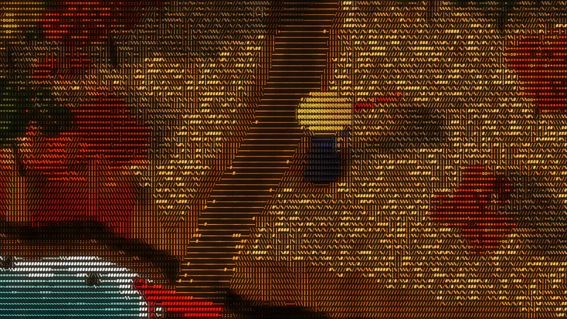





<a href="https://github.com/FreeCAD/FreeCAD/pulls?q=is%3Apr+author%3AAyushjo+is%3Amerged"></a>

<a href="https://github.com/navyabijoy/invisible-notes/pull/15"></a>
<a href="https://github.com/FreeCAD/FreeCAD/pull/32340"></a>
<a href="https://github.com/FreeCAD/FreeCAD/pull/32476"></a>
<a href="https://github.com/FreeCAD/FreeCAD/pull/32629"></a>
<a href="https://github.com/FreeCAD/FreeCAD/pull/33512"></a>
<a href="https://github.com/FreeCAD/FreeCAD/pull/32497"></a>
<a href="https://github.com/FreeCAD/FreeCAD/pull/32618"></a>
<a href="https://github.com/FreeCAD/FreeCAD/pull/33930"></a>
<a href="https://github.com/FreeCAD/FreeCAD/pull/33716"></a>
<a href="https://github.com/FreeCAD/FreeCAD/pull/33540"></a>

<a href="https://github.com/FreeCAD/FreeCAD/pulls?q=is%3Apr+author%3AAyushjo"></a>






<a href="https://github.com/Ayushjo/freediskspace"></a>
<a href="https://github.com/Ayushjo/Strata"></a>
<a href="https://github.com/Ayushjo/Relay"></a>
<a href="https://thecineprism.com"></a>
<a href="https://github.com/Ayushjo/MyOwnDevin"></a>
<a href="https://www.sahaayak.space"></a>







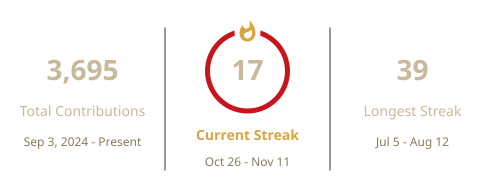

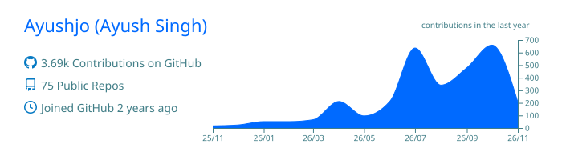



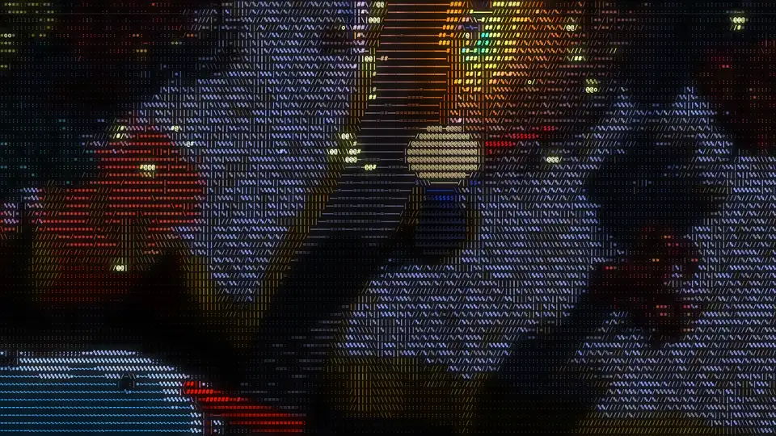

  

Scenes rendered as live ASCII dioramas with <a href="https://github.com/JDhruv14/ascii-diorama">ascii-diorama</a> · textures from <a href="https://polyhaven.com">Poly Haven</a> (CC0) · type: Shippori Mincho (OFL)

